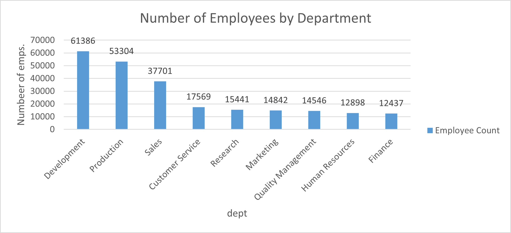
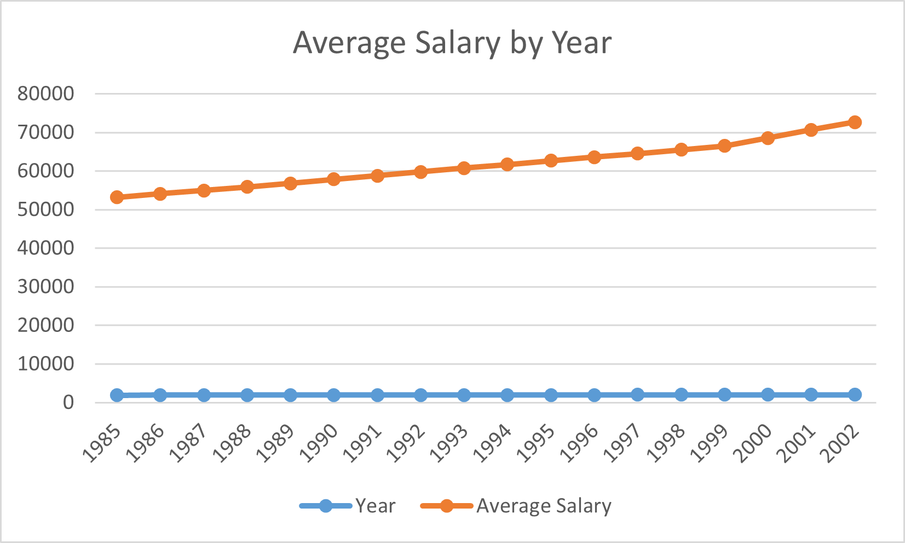
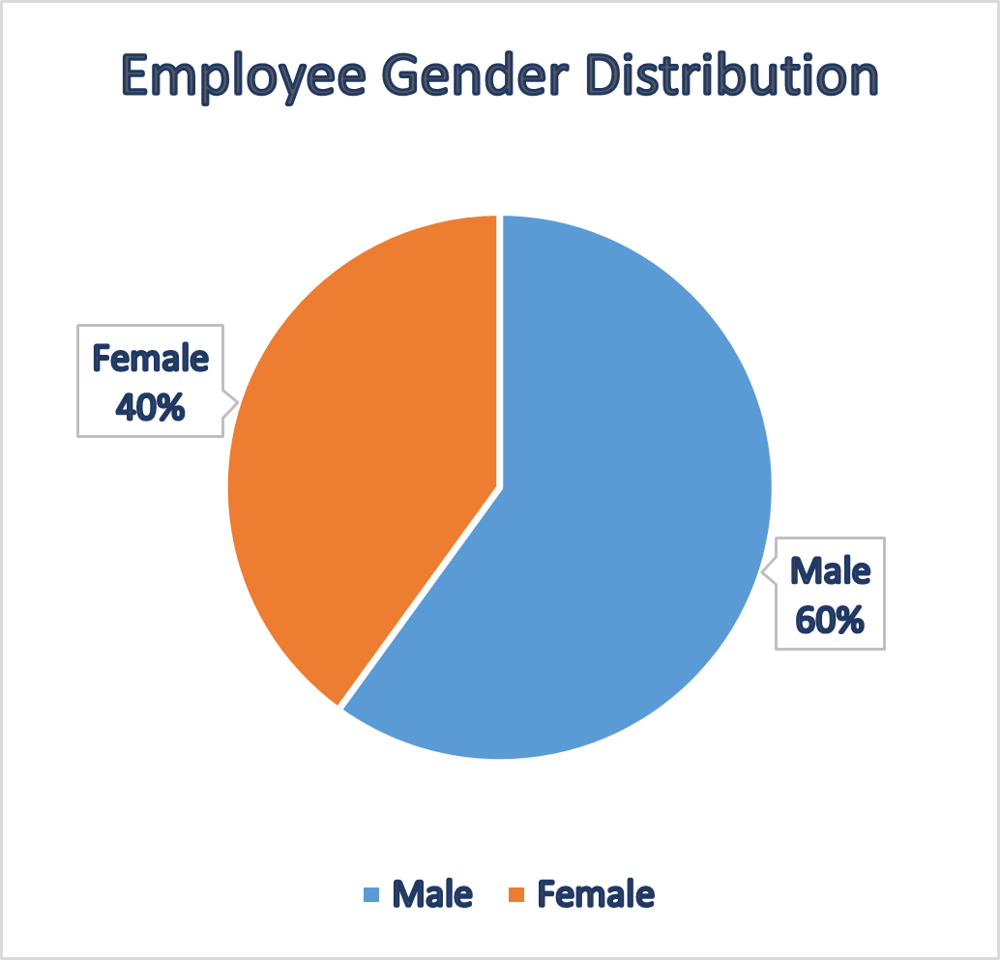

# Employee Database Analysis

**Power BI portfolio project** · [Retail trading review — sales targets, margins and store contribution](retail-power-bi/)

Business Objective

Analyze historical employee records to understand workforce composition, compare employee counts and average salaries across departments, and examine hiring trends over time. SQL is used to explore the data, and Power BI presents the main findings in an interactive dashboard.

Business Questions

Which departments had the largest employee headcount in the dataset’s latest available snapshot?

How did average salary differ across departments in that snapshot?

How did the number of hires change year by year?

## Project Overview

This project focuses on analyzing an employee database using SQL and MySQL.

The goal is to explore employee demographics, analyze salary distributions, compare departments, and identify patterns in employee history.

## Data Scope and Definitions

This project uses the historical MySQL Employees Sample Database. “Current employees” are employees with an active department record in `dept_emp`, and “current salary” is the salary record marked as active in `salaries`. In the standard dataset, active records use `to_date = '9999-01-01'`.

Employee tenure is calculated as of January 1, 2001. Here, “current” refers to the latest active records in this sample database, not to a present-day workforce.

## Tools & Technologies

- MySQL
- SQL
- MySQL Workbench
- GitHub

## Database

The project uses the Employees Sample Database.

Main tables:
- `employees`
- `departments`
- `dept_emp`
- `dept_manager`
- `salaries`
- `titles`

## Project Objectives

1. Analyze employee demographics.
2. Explore salary distributions and trends.
3. Compare employee counts across departments.
4. Examine employee experience and department history.
5. Identify patterns and summarize business insights.

## Key Findings

- The database contains 300,024 employees.
- Male employees account for approximately 60% of the workforce.
- The highest number of employees were hired in 1986.
- Development is the largest department by current employee count.
- Sales has the highest average current salary among departments.
- Most employees in the dataset had more than 10 years of tenure as of January 1, 2001.
- 31,579 employees worked in more than one department.

## Project Structure

```text
employee-database-analysis/
├── README.md
├── sql/
│   ├── 01_basic_analysis.sql
│   ├── 02_department_analysis.sql
│   ├── 03_salary_analysis.sql
│   ├── 04_salary_growth_analysis.sql
│   ├── 05_employee_experience.sql
│   └── 06_department_history.sql
└── results/
    └── findings.md
```

## Key Skills Demonstrated

- SELECT, WHERE, ORDER BY
- GROUP BY and HAVING
- JOIN operations
- Aggregate functions (COUNT, AVG, MIN, MAX)
- Subqueries
- CASE WHEN
- Date functions
- Data analysis and interpretation
- Presenting findings


  ## Data Visualizations

The project includes the following visualizations:

### Employees by Department


### Average Salary by Year


### Employee Gender Distribution


## Project Status

Initial analysis completed.

Further analysis and improvements may be added as the project develops.
