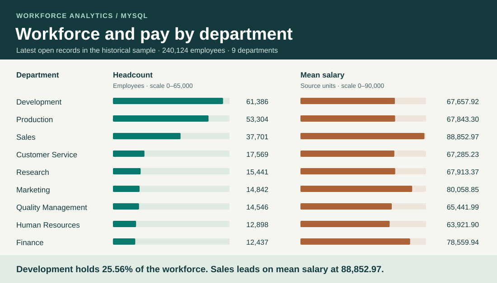
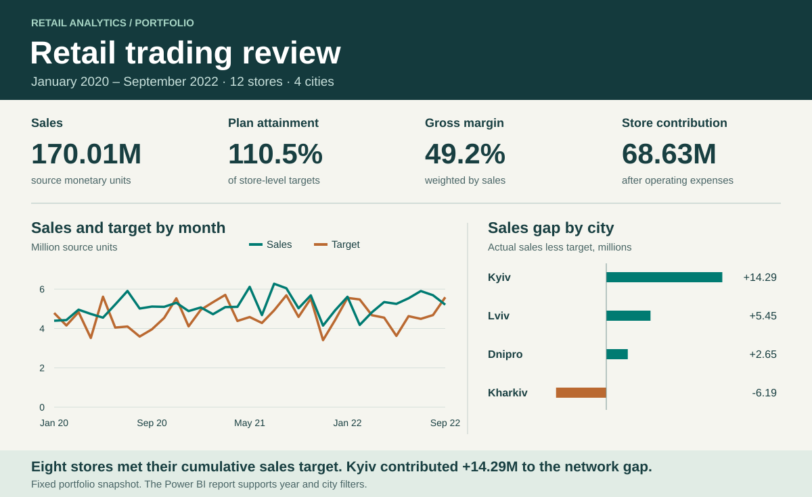

# Data analytics course portfolio

Two projects from my data analytics coursework use different datasets to answer different questions. The SQL case study explores a historical employee database. The Power BI report compares retail sales, targets and store expenses using a separate collection of Excel and CSV files.

| Project | Question | Data and methods | Result |
| --- | --- | --- | --- |
| [Workforce and pay · SQL](sql/) | Which departments employ the most people, and which pay the most on average? | MySQL Employees Sample Database · joins, aggregation, date logic and window functions | Development leads by headcount. Sales leads by average salary. |
| [Retail trading review · Power BI](retail-power-bi/) | Which stores met their sales targets, and how much gross profit remained after operating expenses? | Retail course archive for 12 stores · Power Query, data modeling and DAX | The network reached 110.5% of its target. Eight stores met their individual targets. |

### Workforce and pay · SQL

[Headcount query](sql/02_department_analysis.sql) · [Salary query](sql/03_salary_analysis.sql) · [Full SQL findings](sql/results/findings.md)

### Retail trading review · Power BI

[Explore the report in Power BI Desktop](retail-power-bi/#explore-the-report)
