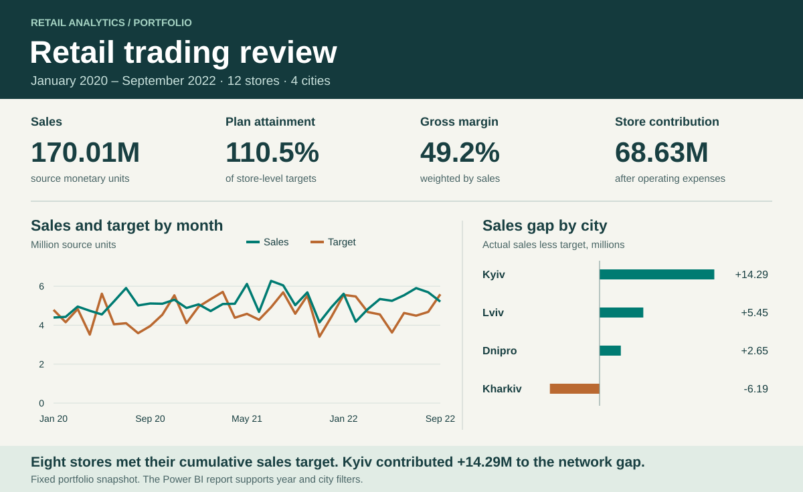

# Retail trading review | Power BI

**Did sales beat the plan, and how much gross profit remained after store expenses?** Across 12 Ukrainian stores, sales reached **170.01M**, or **110.5% of target**. Kyiv finished **14.29M above** its store-level targets, while Kharkiv finished **6.19M below**. The figures cover January 2020 through September 2022 and use the monetary units in the source files.



This retail coursework uses `DataSource Power BI_новий.zip`, a collection of retail Excel and CSV files. The [workforce SQL case study](../sql/) uses the separate MySQL Employees Sample Database.

## Explore the report

Download the repository using **Code → Download ZIP**, extract the whole folder, and open **retail-power-bi/Retail.pbip** in a current version of Power BI Desktop for Windows. Select **Home → Refresh** to load the included snapshot on first open. The report and model folders must be next to the PBIP file. All four data extracts are embedded in Power Query, so refresh works offline. If Desktop prompts for project or enhanced report support, enable the indicated option under **File → Options and settings → Options → Preview features**, restart, and reopen.

| Report page | How to explore it |
| --- | --- |
| Sales vs target | Compare the two monthly lines, rank stores by sales less target and review the city table. Select Kharkiv in the city slicer. The three stores together recorded 34.38M in sales against 40.57M planned. |
| Margin and expenses | Filter by city or year on this page. Read gross margin alongside contribution margin, compare operating expenses across cities, then compare contribution and average receipt by store. |

The two pages have independent year and city slicers. 2022 includes January to September. The image above is a static chart calculated from the same extracts.

## What the comparisons show

| City | Sales, M | Target, M | Gap, M | Attainment |
| --- | ---: | ---: | ---: | ---: |
| Kyiv | 62.01 | 47.72 | +14.29 | 129.9% |
| Lviv | 43.52 | 38.07 | +5.45 | 114.3% |
| Dnipro | 30.10 | 27.45 | +2.65 | 109.6% |
| Kharkiv | 34.38 | 40.57 | −6.19 | 84.7% |
| **Network** | **170.01** | **153.82** | **+16.19** | **110.5%** |

- Eight of twelve stores met their cumulative target. All three Kharkiv stores missed theirs. Nebesna Sotnya had the largest shortfall at 3.02M. Reviewing its monthly targets and sales is a starting point for investigating the gap.
- Dnipro finished above plan overall. Its Atlant store contributed +3.79M, offsetting a 1.14M shortfall at Passage. A city total hides this difference.
- Gross profit was 83.69M (49.2% of sales). Recorded operating expenses of 15.06M left store contribution of 68.63M (40.4%). The workbook does not establish corporate net income.
- In the comparable January–September window, sales were 47.54M in 2022 versus 48.11M in 2021, a 1.2% decrease. These figures describe recorded activity and do not establish its cause.

## From source to model

1. **Read the regional sales feeds.** The supplied `DataSource Power BI_новий.zip` contains the central workbook and regional exports. The `Sale` sheet covers Lviv and Dnipro (7,342 lines). Four Kyiv Excel files supplied 6,154 lines. Three semicolon-delimited Kharkiv CSVs in Windows-1251 supplied 4,521. For Kharkiv the year, month and day fields form the sale date. Regional file numbers map to the store directory (file 4 → store 104).
2. **Align the reporting window.** Sales cover every store-month from January 2020 to September 2022. October and November have no recorded sales, and December contains seven isolated lines. Targets and expenses continue to December. The report compares all three facts over the same 33 months, retaining 18,010 of 18,017 sale lines.
3. **Prepare a public snapshot.** Python and openpyxl read the archive. Sum the source line amount and purchase cost once per line, sum units and count distinct invoice IDs within each store-month. The script checks that a receipt for one store stays within one month. It exports only aggregates and store labels. Customer and supplier fields are unnecessary for this analysis. The sales, cost and plan amounts are assumed comparable across feeds. The source does not specify a currency on these fields.
4. **Use store-level budgets.** Read only numeric store IDs and actual month headers in the sales plan sheet. Some workbook subtotals cover overlapping ranges (for example, the Lviv subtotal in B5 sums B6:B13); rebuilding totals from individual stores avoids double counting. The separate cost plan is outside the scope of sales target attainment. For operating expenses keep the actual scenario marked `факт` and sum all categories to a single store-month expense.
5. **Transform in Power Query.** The four named snapshot expressions contain compressed CSV bytes. The M queries decompress, parse UTF-8 CSV, promote the first row to headers, and assign explicit types. The `Target` query unpivots 33 month columns into one row per store-month. The `Period` query takes distinct sales months and creates the year and chronological month labels.
6. **Build the model.** The dimensions `Store` (12 rows) and `Period` (33 months) each filter the three fact tables through one-to-many, single-direction relationships. Each fact table has 396 rows at store × month. The common dimensions allow the same slicers to filter each fact independently.
7. **Calculate the indicators in DAX.** All 14 measures are defined on `Sales` in the [semantic model](Retail.SemanticModel/model.bim). Percentages divide filtered totals. The count of stores meeting plan evaluates each store separately within the selected period.
8. **Reconcile the result.** On the first page with both slicers cleared, check sales of 170,008,342.42, target of 153,817,078.06, a gap of 16,191,264.36 and eight stores meeting plan. On the second page the model has 8,121 receipts, 53,958 units and gross profit of 83,694,329.94. Amounts in this paragraph are rounded to two decimals; visuals can display rounded units.

### Measure definitions

| Indicator | Calculation |
| --- | --- |
| Sales gap / attainment | Sales less target / sales divided by target, respectively |
| Gross profit / margin | Sales less the summed line purchase cost / gross profit divided by sales |
| Store contribution / margin | Gross profit less recorded operating expenses / contribution divided by sales |
| Average receipt | Sales divided by store-scoped receipt count |
| Stores meeting plan | Stores with positive target and a nonnegative sales gap in the selected period |

```dax
Plan attainment = DIVIDE ( [Sales amount], [Sales target] )
Gross margin = DIVIDE ( [Gross profit], [Sales amount] )
Store contribution = [Gross profit] - [Operating expense]
```

### Rebuild from the original archive

With Python 3.9+ and openpyxl installed, run the following inside this project folder. Close the project in Desktop first. The first script rebuilds the four [public CSV extracts](data/); the second copies those exact extracts into the model's embedded M expressions. Reopen and refresh in Desktop. For a later period, review the explicit comparison window in the extraction script before rebuilding.

```console
python -m pip install openpyxl
python scripts/prepare_data.py "path/to/DataSource Power BI_новий.zip"
python scripts/update_snapshot.py
```

[Report definition](Retail.Report/definition/) · [Data preparation](scripts/prepare_data.py) · [Monthly sales extract](data/sales.csv)

