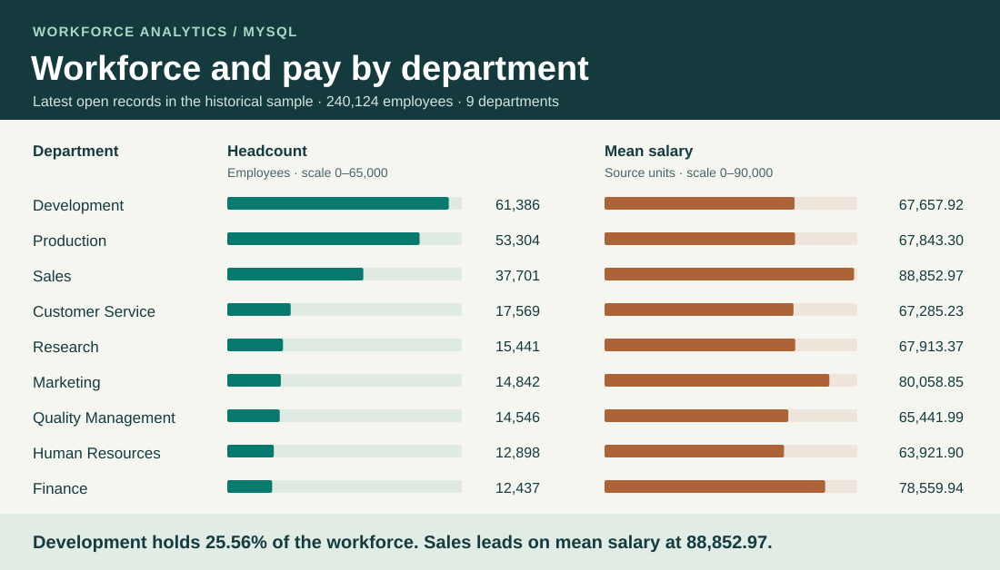

# Workforce and pay | MySQL

**Which departments employ the most people, and which pay the most on average?** Development leads on headcount with **61,386 employees**. Sales ranks third by size and first by mean salary at **88,852.97**. The comparison covers 240,124 open department assignments across nine departments in the historical Employees sample.

## Data and scope

This course project uses the **MySQL Employees Sample Database**, a public dataset of fictional employee records. The separate [Power BI project](../retail-power-bi/) uses retail sales, targets and expenses from course Excel and CSV files.

| Question | Population and date rule |
| --- | --- |
| Who was hired and when? | All 300,024 people in `employees`, counted once by hire date. |
| How do departments compare? | `dept_emp.to_date = '9999-01-01'` marks an open assignment in the historical sample. Pay comparisons also require an open salary for the same employee. |
| How did recorded pay change? | Group salary records by the year their rate took effect. Employees can contribute multiple records over their careers. |
| How much time had passed since hire? | Count completed calendar years from hire to January 1, 2001 for everyone hired by that date, including former employees. |
| How many people changed departments? | Count distinct department IDs per employee across their full assignment history. |

## Follow the analysis

| Query | What to look for |
| --- | --- |
| [01 · Workforce and hiring](01_basic_analysis.sql) | Count people, find the hire-date range and identify the busiest hiring year. |
| [02 · Department headcount](02_department_analysis.sql) | Filter open assignments, count distinct employees and calculate each department’s share of the snapshot. |
| [03 · Department pay](03_salary_analysis.sql) | Join open assignments to open salaries. Compare the salary count with headcount to check coverage. |
| [04 · Salary history](04_salary_growth_analysis.sql) | Use a common table expression and `LAG()` to compare each year’s mean effective salary with the preceding year’s mean. |
| [05 · Time since hire](05_employee_experience.sql) | Use `TIMESTAMPDIFF` and `CASE` to place employees in nonoverlapping bands at a fixed date. |
| [06 · Department mobility](06_department_history.sql) | Count people with more than one distinct department and inspect a reproducible sample of assignments by employee ID. |

## Run the queries

1. Use **MySQL 8.0 or later** and the public [Employees database revision used for reconciliation](https://github.com/datacharmer/test_db/tree/e324b56193ca506ab7cc1ab143a9153d8c4535d7). If the sample is already installed, skip the import. For a first import, use a disposable instance because the upstream installer recreates the `employees` database. [MySQL installation instructions](https://dev.mysql.com/doc/employee/en/employees-installation.html)
2. In MySQL Workbench, open a connection and double-click the `employees` schema to make it active. Open any numbered SQL file and run the full script. Each script reads the source tables and can run independently.
3. To reproduce the chart, run queries **02** and **03**, match their rows by department and sort by headcount. Development should return **61,386** in both counts and a mean salary of **67,657.92**.

[Full findings and denominator checks](results/findings.md) · [Original Excel charts and summary tables](results/data_visualizations.xlsx) · [Course portfolio](../)

The sample data is credited to Fusheng Wang and Carlo Zaniolo, with the MySQL schema by Giuseppe Maxia and conversion by Patrick Crews. Aggregate results and the comparison graphic are derived from the sample. [Upstream credits](https://github.com/datacharmer/test_db/blob/e324b56193ca506ab7cc1ab143a9153d8c4535d7/employees.sql) · [Dataset license, CC BY-SA 3.0](https://creativecommons.org/licenses/by-sa/3.0/)
